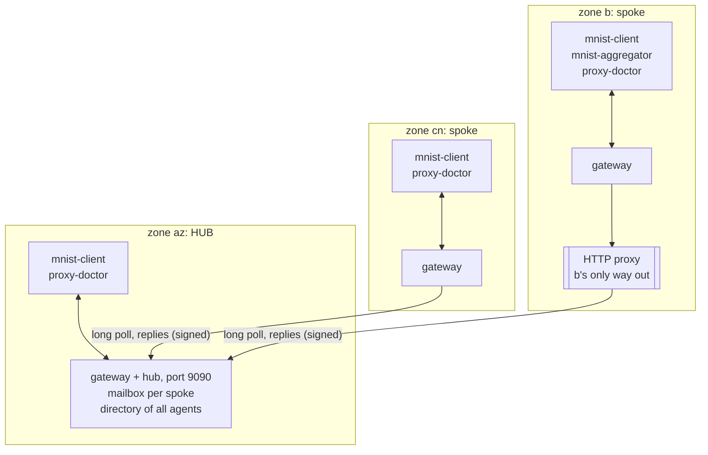
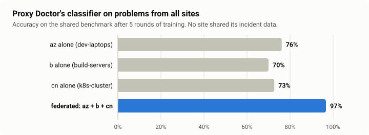
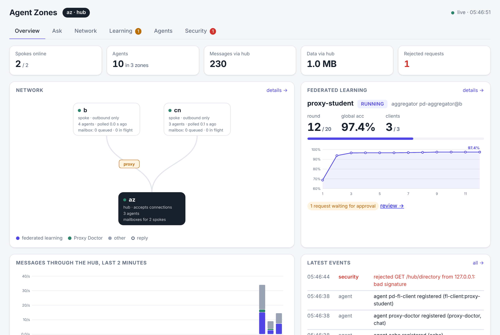
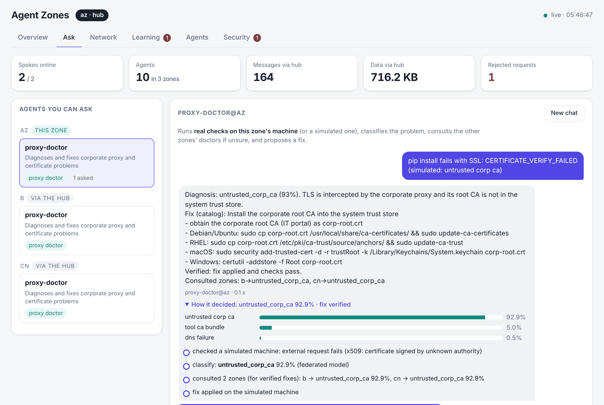

# Agent Zones

An **agent zone** is a Docker Compose stack that hosts AI agents, MCP servers and, optionally, a local LLM
(Ollama). Each zone is configured in **one file** (`zones/<zone>/zone.yml`) and started with **one command**
(`scripts/zone.sh <zone>`).

Zones form a **hub-and-spoke** network. Only the hub accepts incoming connections; spokes open outbound
connections only, through an HTTP proxy if that is their only way out. On top of that run two applications:
**Proxy Doctor**, which diagnoses corporate proxy and certificate problems and shares verified fixes between
zones, and **generic federated learning**, which trains a model across zones without moving any data.

## Topology: hub and spoke

Arrows show who opens the connection. Every arrow points at the hub: nothing ever connects into b or cn.



- **Hub** (`ROLE: hub`): keeps a mailbox for each spoke zone and the directory of agents in all zones.
- **Spoke** (`ROLE: spoke`): long-polls the hub for its mailbox, delivers messages to its local agents and
  posts the replies back. It also tells the hub which agents it hosts. `HUB_PROXY` sends this traffic through
  an HTTP proxy.
- A message from b to cn travels b → hub → cn, and the reply comes back the same way. No connection is ever
  opened *into* b or cn.
- Spokes acknowledge every message they receive; anything not acknowledged within 30 s is delivered again,
  and spokes drop duplicates. A send that is retried after a lost response is routed only once. Agents
  re-register with their gateway every 10 s, so restarting a gateway, or the hub, is harmless.
- A spoke that stops polling for 30 s is **offline**: its agents leave the directory at once, and messages for
  it are refused right away instead of waiting for a timeout.
- Each spoke has its own token (`SPOKE_TOKENS` on the hub, `HUB_TOKEN` on the spoke). It is used as an HMAC
  key and never sent. A spoke can only fetch its own mailbox, can only answer requests that were sent to it,
  and cannot claim to be another zone. See [docs/SECURITY.md](docs/SECURITY.md).

Agents only ever talk to their own zone's gateway:

| Call | Purpose |
|---|---|
| `GET /directory?capability=...` | agents in all zones (`*` wildcards work, e.g. `fl-client:*`), with each agent's `version` and `accepts` |
| `POST /send {target_zone, target_agent, payload, timeout?}` | send a request, get the reply |
| `POST /agents/register {name, url, capabilities, version, accepts}` | done for you by the agent host |

An agent is a subclass of `agentzones.agent.Agent` with one method, `async handle(msg) -> reply`, run by
`agentzone agent` with `AGENT_IMPL=module:Class`. `msg.local` tells you whether the sender is in your own zone.
Set `accepts` on the class to the message types it handles, e.g. `{"fl.status": "{} -> state, round"}`; it is
published in the directory, so other agents, MCP clients and LLM agents know what they can send.
`self.gw.send_all(capability, payload)` sends to every matching agent at once and returns their replies.

Each agent process sends a random secret with its calls, made up at start; there is nothing to configure. A
live agent's name cannot be registered by another container, and a send is always marked with the name of the
agent that sent it. See [docs/SECURITY.md](docs/SECURITY.md#agents-inside-a-zone).

## Generic federated learning



Each site's data covers mostly its own kind of problems, so a model trained on one site alone misses the
others'. Trained federated across the three zones, it handles all of them, and no site shared its data. The
numbers come from real runs of the plugins: `python scripts/make_doc_charts.py` (details and per-round charts in
[docs/ARCHITECTURE.md](docs/ARCHITECTURE.md#federated-learning)).

The agents in `agentzones/fl/` only do communication and the training lifecycle. Everything specific to a
model is a plugin:

| Plugin | Where it runs | You implement |
|---|---|---|
| `fl.ClientTask` | each client | `fit(parameters, config) -> (parameters, num_samples, metrics)`, optional `evaluate`, `on_global` |
| `fl.Strategy` / `fl.FedAvg` | aggregator | `initial_parameters()`, optional `configure_fit`, `aggregate_fit`, `evaluate` |

Model parameters are passed around as `dict[str, numpy.ndarray]`, so any framework works (numpy, a PyTorch
`state_dict`, Keras weights, ...). Plugins are picked in the zone file:

```yaml
mnist-client:
  extends: { file: ../../zone/base.yml, service: fl-client }
  environment: { AGENT_NAME: mnist-client, FL_JOB: mnist, FL_TASK: tasks.mnist:MnistClient, FL_CLIENT_INDEX: "0" }
mnist-aggregator:
  extends: { file: ../../zone/base.yml, service: fl-aggregator }
  environment: { AGENT_NAME: mnist-aggregator, FL_JOB: mnist, FL_STRATEGY: tasks.mnist:MnistStrategy,
                 FL_ROUNDS: "10", FL_MIN_CLIENTS: "3", FL_MIN_FIT_CLIENTS: "2" }
```

- Clients advertise the capability `fl-client:<FL_JOB>`. The aggregator looks them up again every round, so
  clients can join or leave between rounds.
- Lifecycle of a run: `idle → waiting_for_clients → running → done | failed | stopped`. A round counts if at
  least `FL_MIN_FIT_CLIENTS` clients reply within `FL_ROUND_TIMEOUT_S`; a short round is retried
  (`FL_MAX_ROUND_RETRIES`, default 3) before the run fails.
- Updates are screened before FedAvg: wrong parameter names or shapes and NaN are rejected; `FL_MAX_SAMPLES`
  caps the sample count one client can claim; an update more than `FL_MAX_UPDATE_RATIO` (default 10) times
  the median size is dropped. Each round's history records every client's share, update size and status.
- The global model is evaluated by the strategy each round; clients' own metrics are kept per client too.

### Who can start training

| Who | How | What happens |
|---|---|---|
| Operators (`FL_OPERATORS`, default `operator,cli,dashboard-operator`) | `fl.start {rounds?}`, `fl.stop` | runs at once |
| Anyone else, e.g. an LLM agent | MCP tools `fl_request_start(job, rounds, reason)`, `fl_request_stop(job, reason)`, or the message `fl.request` | waits as *pending* until an operator sends `fl.approve {id}` or `fl.reject {id}`, from the dashboard or `agentzone fl approve --id …`. `FL_APPROVAL=auto` skips the wait |
| The aggregator itself | `FL_SCHEDULE_S` | starts a run every N seconds when idle |

Hard limits, enforced by the aggregator whoever asks: at most `FL_MAX_ROUNDS` (50) rounds per start,
`FL_COOLDOWN_S` between runs, and `FL_CONTROL_ZONES` for which zones may control a job. Every start, stop,
request and decision goes to an audit log (in `fl.status` and `/models/<job>-audit.jsonl`) with who, when and
the reason given. The zone MCP server also has `fl_list_jobs()` and `fl_status(job)`; no tool can choose a
plugin, data or hyperparameters. The `assistant` LLM agent (`COMPOSE_PROFILES=llm`) gets these tools.

Sender names are what the sending zone says they are, so the trust boundary is the zone: anyone with access to
a zone's local API can act as an operator of that zone.
- The global model is saved to `/models/<job>-latest.npz` with `<job>-latest.json` (the `models` volume in
  zone b). At the end of a run it is also sent to every client (`fl.model`); a client with `FL_MODEL_OUT`
  saves it.
- To add a model, create `tasks/<name>.py` with a `ClientTask` and a `Strategy` and point `FL_TASK` /
  `FL_STRATEGY` at them. If you need extra libraries (e.g. torch), add them to `deploy/Dockerfile`.

Two plugins are included:
- [tasks/mnist.py](tasks/mnist.py): a numpy MLP, with each client holding one third of MNIST. Set `LABELS` on a
  client (`AZ_LABELS`, `B_LABELS`, `CN_LABELS`) to make its data non-IID. Five rounds reach about 95% test
  accuracy.
- [tasks/proxy_student.py](tasks/proxy_student.py): the Proxy Doctor classifier, trained on each site's own
  incidents. Works offline in milliseconds; used by the tests and the demo.

## Proxy Doctor

`proxy_doctor/` is an agent that diagnoses and fixes corporate proxy and TLS-inspection problems on its own
machine. It uses an MCP server for the checks and a small student model to classify them. When it is unsure,
it consults the proxy doctors of the other zones (`pd.consult`), sending only the diagnostic observation with
credentials redacted. A fix is shared with the other zones (`pd.fix`) only after it has been applied and the
checks pass again. Received fixes are never applied without verifying them locally.

```bash
python -m agentzones.cli --gateway http://127.0.0.1:8081 ask proxy-doctor "pip fails with 407" --simulate proxy_auth_required
```

Training the student and the small LLM is covered in [docs/DISTILLATION.md](docs/DISTILLATION.md).

## Dashboard



Every gateway serves a live dashboard on its local API: **http://127.0.0.1:8080/** for the hub (b: 8081,
cn: 8082). It needs nothing from the internet, so it also works on an offline VM.

The hub's dashboard has six pages, most with a diagram of how that part works:

| Page | Shows |
|---|---|
| Overview | the zones with messages moving between them, the current FL job, messages per second, latest events |
| Ask | chat with any agent that can chat (`chat` capability), in any zone; each answer can be opened to show how it was reached: the tools an LLM agent called and what they returned, or Proxy Doctor's confidence per problem, steps, consulted zones and fix |
| Network | spokes (online, last poll, mailbox), how a message travels b → proxy → hub → cn, traffic per second and per route, the traffic log |
| Learning | job controls and pending requests with Approve / Reject, the run lifecycle (current state lit), the steps of a round, global and per-client accuracy, each client's FedAvg share and update size, time per round, the audit log |
| Agents | all agents by zone, the Proxy Doctor flow, verified fixes per zone and whether each doctor uses the federated model |
| Security | how request signing works, what a proxy can and cannot do, rejected requests, all events |

Which agents you can ask, and what they do for other zones:

| Agent | From its own zone | From another zone |
|---|---|---|
| `assistant` (LLM) | the local model with the zone's tools (Proxy Doctor's, FL requests) | the model only; tools listed in `LLM_REMOTE_TOOLS` |
| `code-assistant` (LLM) | reads the code in `CODE_DIR` (read-only MCP server: list, search, read) | the model only, unless `CODE_REMOTE_TOOLS=code.*` |
| `proxy-doctor` | checks the machine (or a simulated one), consults other zones, proposes a fix | advice from the question's text and its verified fixes; no checks |



`assistant` and `code-assistant` come with `COMPOSE_PROFILES=llm` (or `host-llm`); `code-assistant` is in zone az
and reads this repository unless `CODE_DIR` says otherwise. On a laptop: `agentzone laptop --code ~/src/project`.
`python scripts/demo.py --keep --llm` adds both to the demo, using Ollama on this machine. A chat is kept in the
browser tab; each question sends the last turns along, so the agents themselves keep no state.

The hub only records each message's type and size, never its contents. A spoke's dashboard shows its own view:
its hub connection, the directory and the FL jobs. If `ZONE_API_TOKEN` is set, open the page as
`http://127.0.0.1:8080/#token=<token>`.

## Local models and laptops

Agents call any OpenAI-compatible server (`MODEL_URL`, `MODEL_NAME`); Ollama is the easy choice. The model can
come from the Ollama library, Hugging Face, an internal mirror or a file (`MODEL_SOURCE`), and
`agentzone model setup` loads it. Models from the Azure ML registry are downloaded once and used as a file.
For Docker zones, `COMPOSE_PROFILES=llm` adds an Ollama container (`AGENTZONES_GPU=1` for NVIDIA GPUs) and
`host-llm` uses the host's server.

On a personal or work laptop, run a whole zone natively, as a spoke of the hub or on its own:

```bash
agentzone laptop --zone laptop-alice --hub http://<az-host>:9090 --token <token>
```

The hub accepts laptops listed in `EXTRA_SPOKE_TOKENS`. Which model fits which machine, and the details:
[docs/MODELS.md](docs/MODELS.md).

## Try it without Docker

```bash
pip install -e '.[dev]'
```

```bash
python scripts/demo.py
```

The demo runs az, cn and b in one process, with b's traffic going through a small HTTP proxy, and goes through
messaging, Proxy Doctor, federated learning and a rejected token. `--keep` leaves the zones running on the same
ports as the Docker zones, with the hub dashboard at http://127.0.0.1:8080/.

## Run locally with Docker (all three zones on one host)

```bash
scripts/zone.sh az
```

```bash
scripts/zone.sh cn
```

```bash
COMPOSE_PROFILES=sim scripts/zone.sh b
```

```bash
scripts/zone.sh b logs -f mnist-aggregator
```

`COMPOSE_PROFILES=sim` adds [zones/b/sim.yml](zones/b/sim.yml). It puts b on an internal Docker network
whose only way out is a squid proxy, so the network constraints are enforced: b's gateway cannot reach the hub
or the internet directly, and nothing can connect into b or cn. b's agents download MNIST through the same
proxy.

Check status or start a new run from any zone (local API ports: az=8080, b=8081, cn=8082):

```bash
curl -s localhost:8082/send -H 'content-type: application/json' \
  -d '{"target_zone":"b","target_agent":"mnist-aggregator","payload":{"type":"fl.status"}}'
```

```bash
python -m agentzones.cli --gateway http://127.0.0.1:8080 fl start --job mnist --rounds 5
```

Other useful commands: `agentzone status`, `agentzone directory -c 'fl-client:*'`,
`agentzone send b proxy-doctor '{"type": "status"}'`. Add `--gateway http://127.0.0.1:<port>` to pick the zone.

## Deploy on real hosts

| Zone | Before running `scripts/zone.sh <zone>` |
|---|---|
| az (Azure VM) | `export GATEWAY_BIND=0.0.0.0 ZONE_B_TOKEN=... ZONE_CN_TOKEN=...` and allow inbound TCP 9090, ideally only from the spokes' egress IPs. [deploy/azure/deploy-vm.sh](deploy/azure/deploy-vm.sh) does all of it |
| b | `export HUB_URL=http://<az-host>:9090 HUB_PROXY=http://<proxy>:<port> HUB_TOKEN=<ZONE_B_TOKEN>` |
| cn | `export HUB_URL=http://<az-host>:9090 HUB_TOKEN=<ZONE_CN_TOKEN>` |

Generate tokens with `python -m agentzones.cli token`; use a different one per spoke. Settings can also go in
`zones/<zone>/.env` (see [.env.example](.env.example)). Each zone file attaches to a Docker network called
`agent-mesh`, which `scripts/zone.sh` creates if it is missing. On separate hosts it has no other effect.

Ports: the hub API (9090) is the only port that is ever published beyond `127.0.0.1`. The local API (8080
inside every zone) and the MCP server (8000 inside, 8000/8001/8002 on the host) are published on `127.0.0.1`
only.

Other settings:
- `AGENT_BLAS_THREADS` (default 2) caps numpy's threads. If several agents share one host, leaving this
  unlimited made rounds about 250× slower.
- `HOST_CA_BUNDLE` is a CA bundle that agents trust for HTTPS downloads behind a TLS-inspecting proxy.
  `AGENT_HTTPS_PROXY` is the proxy they use for those downloads. `MNIST_URL` can point at an internal mirror.
- `COMPOSE_PROFILES=llm` adds Ollama and a generic `assistant` LLM agent to a zone; `host-llm` adds the
  assistant on the host's model server. See [docs/MODELS.md](docs/MODELS.md).
- `APT_PACKAGES=` builds the image without apt, if the build network cannot reach a Debian mirror.

## Security notes

- **Traffic from b to az is plain HTTP.** Every request is signed with the spoke's token, which is never sent,
  and every answer is signed by the hub, so the proxy cannot steal the token, change a message or replay one.
  It **can read** messages and model weights. Mitigations, best first:
  - Use HTTPS on the hub (for example an Azure Application Gateway or Caddy in front of port 9090) if the proxy
    allows `CONNECT`.
  - Otherwise, restrict the hub's inbound access to the spokes' egress IPs, and don't send secrets in
    messages.
- Replace the `dev-token-*` defaults (the hub and the spokes log a warning while they are in use), and use a
  different random value for each spoke.
- Delivery is at-least-once. Spokes drop duplicates they have seen; FL clients also answer an overlapping
  `fl.fit` with `busy`.
- The hub's mailboxes are in memory. If the hub restarts, messages in flight are lost; the senders time out and
  the aggregator skips that client for the round.
- The MCP server (`list_agents`, `send_message`, `fl_*`) can reach every agent in every zone. That is why its
  port is published on `127.0.0.1` only. Its FL tools can only *request* training; an operator approves.
- Hub requests are limited to 32 MB (`MAX_BODY` in gateway.py); raise it for large models.

Details, including a traffic matrix: [docs/SECURITY.md](docs/SECURITY.md). Protocol and internals:
[docs/ARCHITECTURE.md](docs/ARCHITECTURE.md). Hackathon script: [docs/DEMO.md](docs/DEMO.md). Working on the
code: [docs/DEVELOPMENT.md](docs/DEVELOPMENT.md).

## Tests

```bash
pytest -q
```

The tests cover request signing and replay protection, hub routing and redelivery, FedAvg, the LLM agent's
tool loop against a fake model, the MCP server, and three live zones over HTTP. In those, b's traffic goes
through a proxy, including a proxy that tampers with messages. They also run Proxy Doctor across zones and a
complete federated-learning run.

Setting up a checkout, running zones while you change code, and what CI checks:
[docs/DEVELOPMENT.md](docs/DEVELOPMENT.md).

## Repository layout

| Path | What |
|---|---|
| `agentzones/gateway.py`, `hub.py`, `security.py` | gateway (local API + hub API), mailboxes and routing, signing |
| `agentzones/dashboard.py`, `static/dashboard.html` | the zone dashboard |
| `agentzones/agent.py`, `llm_agent.py`, `mcp_gateway.py` | agent base class and host, LLM agent, zone MCP server |
| `agentzones/models.py`, `laptop.py` | `agentzone model setup`, `agentzone laptop` |
| `agentzones/fl/` | generic FL: plugin interfaces, client and aggregator agents |
| `tasks/` | FL plugins (MNIST, Proxy Doctor student) |
| `proxy_doctor/` | Proxy Doctor: diagnostics, MCP server, student model, distillation |
| `zone/base.yml`, `zones/*/zone.yml`, `scripts/zone.sh` | the zones |
| `scripts/make_doc_charts.py` | regenerates the charts in `docs/images` from real runs of the FL plugins |
| `deploy/` | Dockerfile, Azure VM, Azure ML fine-tune job |
