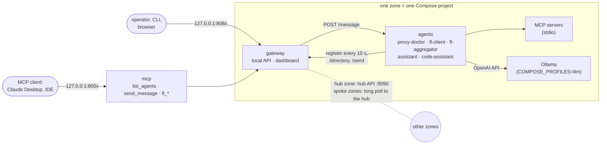
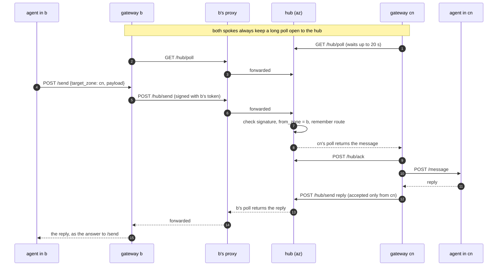
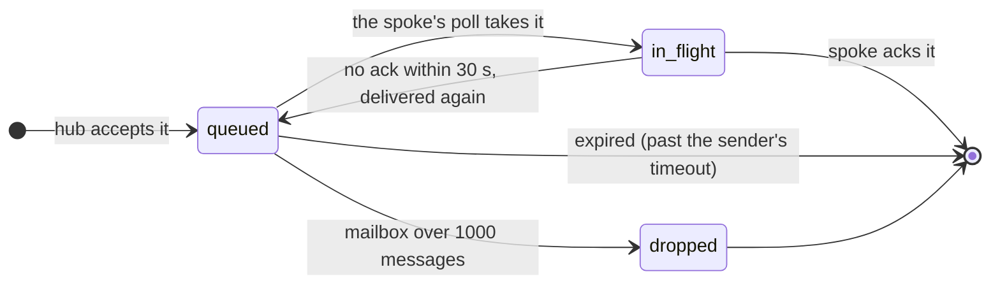
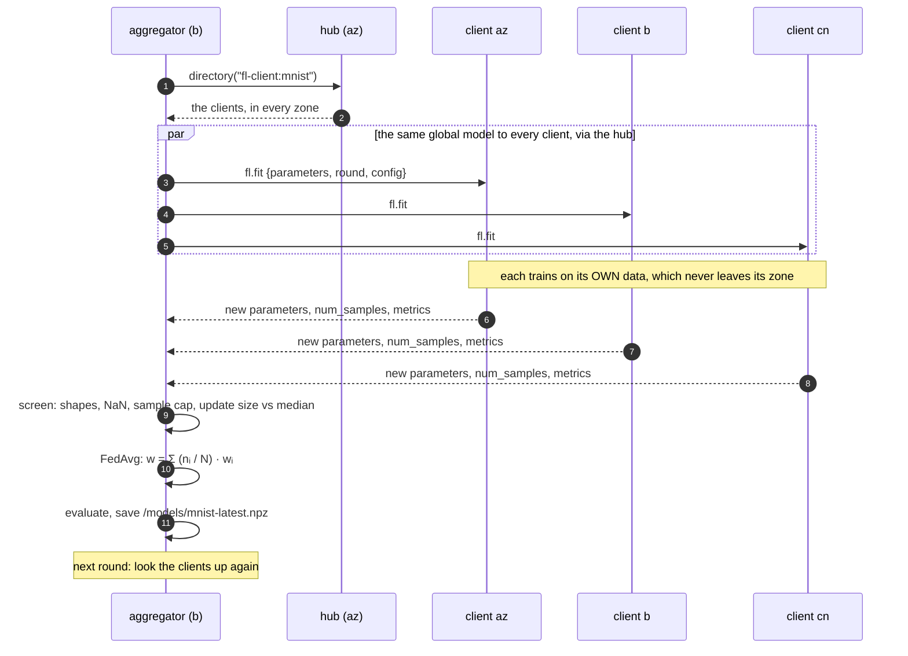
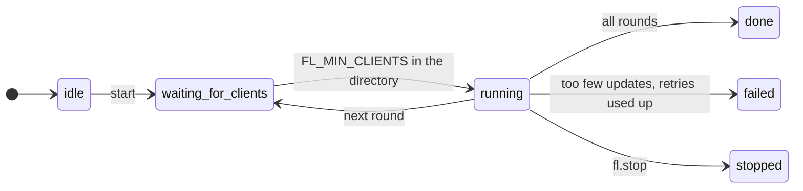
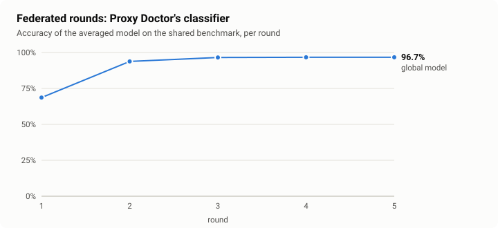
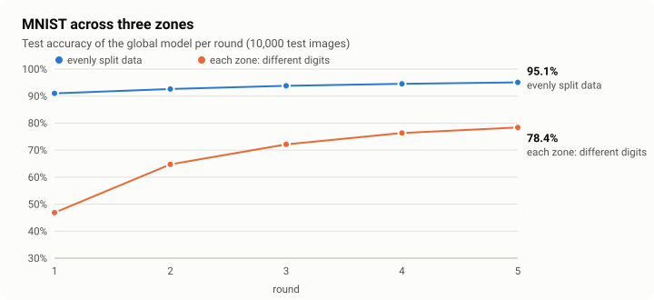
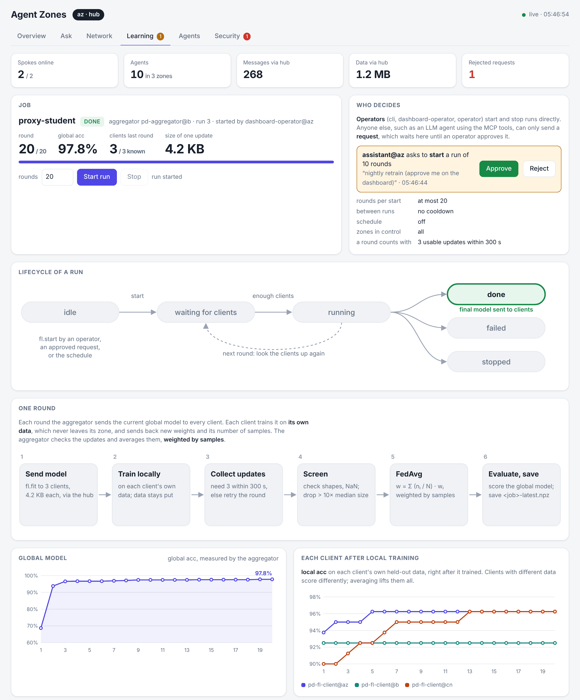
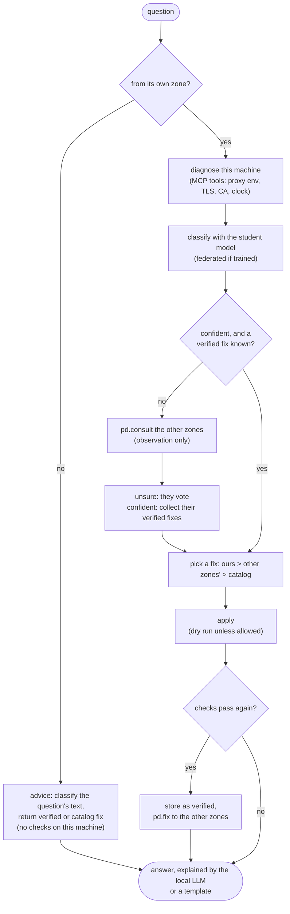

# Architecture

## A zone



* **Gateway** ([agentzones/gateway.py](../agentzones/gateway.py)): one per zone, configured by environment
  variables (`ZONE`, `ROLE`, `HUB_URL`, `HUB_TOKEN`, `HUB_PROXY`, `SPOKE_TOKENS`). It keeps the list of local
  agents (30 s TTL) and routes messages: to a local agent, to the hub (spoke), or into a mailbox (hub).
* **Agents** ([agentzones/agent.py](../agentzones/agent.py)): one container each, all from the same image.
  `AgentHost` serves `POST /message` and re-registers with the gateway every 10 s. Agents see the gateway
  through `GatewayClient.directory()`, `send()` and `send_all()` (directory + send to each match), nothing
  else. Directory entries carry `zone`, `agent`, `capabilities`, `description`, `version` and `accepts`
  (message type → payload description). Every call carries the agent's `X-Agent-Token`, see
  [SECURITY.md](SECURITY.md#agents-inside-a-zone).
* **MCP server** ([agentzones/mcp_gateway.py](../agentzones/mcp_gateway.py)): `list_agents` and
  `send_message` over streamable HTTP (`POST /mcp`) or stdio, for Claude Desktop, IDEs and other MCP clients.
* **Dashboard** ([agentzones/dashboard.py](../agentzones/dashboard.py)): `GET /` and `GET /dashboard/data` on
  the local API. The gateway gathers the data itself (FL status every 1.5 s, Proxy Doctor status every 8 s,
  shared by all open tabs) by sending messages as agent `dashboard`. The hub keeps a ring buffer of the last
  300 messages it routed (type, size, sender, receiver; no payloads) and per-route totals. Spokes report
  whether they use a proxy when they register; the hub tells them its zone name in return.
* **LLM agent** ([agentzones/llm_agent.py](../agentzones/llm_agent.py)): a tool-calling loop on the local
  model with MCP tools plus `zone.list_agents` and `zone.send_message`. Agent-to-agent chains stop after two
  hops.

## Messages

```json
{"id": "…", "kind": "request", "from_zone": "b", "from_agent": "mnist-aggregator",
 "to_zone": "cn", "to_agent": "mnist-client", "payload": {"type": "fl.fit", "...": "..."}, "expires": 1767225600.0}
{"id": "…", "kind": "reply", "reply_to": "<request id>", "from_zone": "cn", "to_zone": "b", "payload": {"...": "..."}}
```

### A message from b to cn, step by step



`POST /send` creates a request, waits for the reply (up to `timeout`, default 60 s) and returns its
payload. `expires` travels with the message; the hub drops messages that are past it, and the receiving
gateway gives the agent only the time that is left.

## Hub protocol (spoke → hub, HTTP + JSON, every call signed)

| Call | Purpose |
|---|---|
| `POST /hub/register {agents}` | this spoke's agents for the directory (every 10 s; entries expire after 60 s) |
| `GET /hub/directory` | agents of all zones |
| `GET /hub/poll?wait=20` | long poll: returns this spoke's messages (requests for its agents, replies to its requests) |
| `POST /hub/ack {ids}` | acknowledge received messages |
| `POST /hub/send {message}` | a request from one of this spoke's agents, or a reply from one |

The spoke runs two loops: register, and poll → ack → deliver. It acknowledges a batch as soon as it receives
it and remembers message ids for 15 minutes, so a redelivered message is not handled twice. A message the hub
handed out but did not see acknowledged within `ACK_TIMEOUT_S` (30 s) goes back to the mailbox; the long poll
wakes up for it. Mailboxes hold at most 1000 messages per spoke.

### A message in a spoke's mailbox



### Routing rules on the hub

* A spoke is **online** while it has a long poll open or polled in the last 30 s. Offline spokes' agents are
  left out of the directory, and requests for them are refused at once.
* Routing is idempotent: the hub remembers message ids per sender for 10 minutes, so a send retried after a
  lost response is not routed twice (and a retried reply is not refused).

* A request's `from_zone` is always the authenticated sender, whatever the message says.
* A request for an unknown zone is refused (HTTP 403, `/send` returns 404).
* When a request is routed, the hub remembers `(from_zone, to_zone)` for it. A reply is accepted only from
  `to_zone`, only once, and delivered only to `from_zone`. A spoke therefore cannot answer requests meant for
  another zone, and cannot inject replies into other zones' conversations.
* Messages for the hub's own zone are delivered to its local agents directly.

## Federated learning

### One round



### Lifecycle of a run



`fl.stop` also stops a run that is still waiting for clients, and a new start from done, failed or stopped goes
back to waiting for clients. A run starts by `fl.start` from an operator, an approved `fl.request`, or `FL_SCHEDULE_S`. When it is done the
final model goes to every client. It fails after `FL_MAX_ROUND_RETRIES` rounds in a row with fewer than
`FL_MIN_FIT_CLIENTS` usable updates. A spoke drops a redelivered message it has already seen.

### What it achieves

Real runs of the plugins in `tasks/`, five rounds each (`python scripts/make_doc_charts.py`).



| round | 1 | 2 | 3 | 4 | 5 |
|---|---|---|---|---|---|
| Proxy Doctor's classifier, shared benchmark | 68.7% | 93.8% | 96.6% | 96.7% | 96.7% |



| round | 1 | 2 | 3 | 4 | 5 |
|---|---|---|---|---|---|
| MNIST, each zone a third of all digits | 91.0% | 92.6% | 93.8% | 94.5% | 95.1% |
| MNIST, az: 0–3, b: 4–6, cn: 7–9 | 46.9% | 64.7% | 72.2% | 76.3% | 78.4% |

When every zone holds different digits (`LABELS`), each client pulls the model towards its own classes and plain
FedAvg needs many more rounds. That is the classic non-IID problem; FedProx or server momentum are the usual
next steps.

The dashboard's *Learning* page shows the same for a live run: the lifecycle with the current state lit, the
steps of a round, global and per-client accuracy, and each client's share in the average.



### Details

Before averaging, the aggregator screens the updates: names, shapes and NaN; `FL_MAX_SAMPLES` caps claimed
sample counts; updates whose distance from the global model is over `FL_MAX_UPDATE_RATIO` × the median are
dropped (with 3 or more updates). Each round's history keeps, per client: status, samples, share in the
average, update size, time and its own metrics. The dashboard draws these.

Starting and stopping: operators (`FL_OPERATORS`) send `fl.start` / `fl.stop`; everyone else sends
`fl.request`, which waits for `fl.approve` / `fl.reject` from an operator (unless `FL_APPROVAL=auto`).
`FL_MAX_ROUNDS`, `FL_COOLDOWN_S`, `FL_CONTROL_ZONES` and `FL_SCHEDULE_S` are enforced by the aggregator, and
every decision is appended to `<FL_MODEL_DIR>/<job>-audit.jsonl`. The zone MCP server's `fl_request_start` /
`fl_request_stop` send `fl.request`, so an LLM agent can propose training but not start it.

Parameters travel as a base64 `.npz` (float32) inside the message. The aggregator re-reads the directory every
round. A client that is busy (a redelivered `fl.fit`), times out or returns bad parameters counts as a failure
for that round; the round still counts with `FL_MIN_FIT_CLIENTS` results.

## Proxy Doctor flow



* The **observation** holds only diagnostics: env flags with redacted proxy credentials, HTTP status codes and
  error strings, the TLS issuer, CA store checks and clock skew. Files and secrets are never included.
* The **student** is a softmax classifier over 27 structured features plus 256 hashed error-text features,
  about 2.5k parameters. It is distilled from a teacher and improved with federated learning
  (`tasks/proxy_student.py`). With `PD_MODEL_PATH` the doctor reloads the federated model whenever the file
  changes. The local LLM writes the explanation, but the decision does not depend on it.
* **Verification** means the doctor re-runs the checks after applying the fix and the external (and internal)
  request now succeeds. Only verified fixes are shared.
* **Other zones** can consult (their observation, classified by our model, plus our verified fixes), ask in
  plain words (``ask`` from another zone gets *advice*: the error text in the question is classified, and our
  verified or catalog fix is returned; nothing runs on this machine) and push fixes. A pushed fix is stored as verified by the *sending* zone only, and is not applied until the local
  doctor verifies it.
