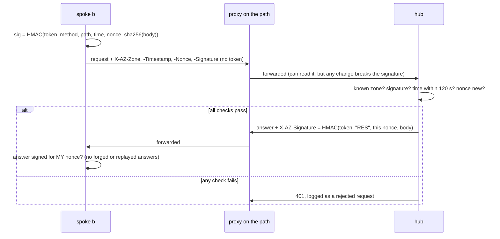
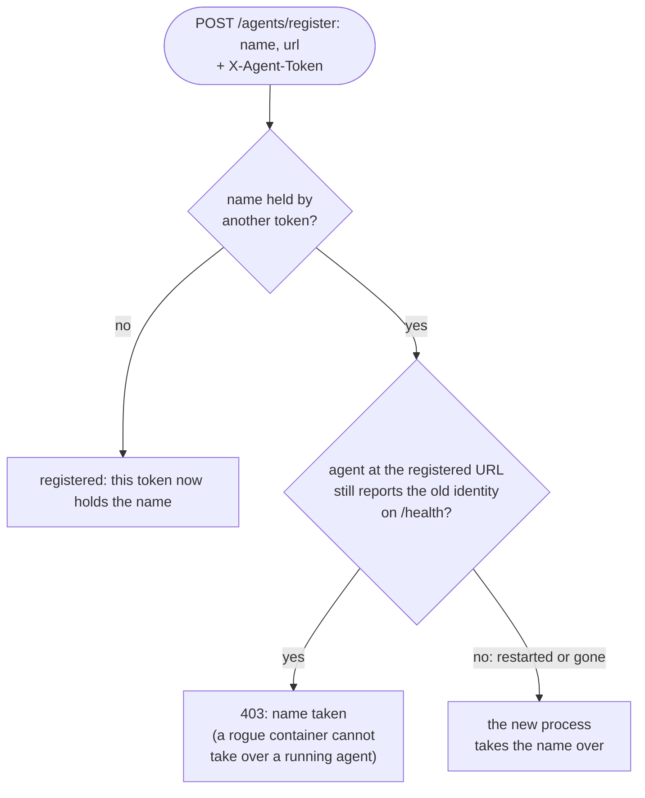

# Security and allowed traffic

## Traffic matrix

| From | To | Port / protocol | Required | Notes |
|---|---|---|---|---|
| Spoke gateway (b, cn) | Hub (az) | TCP 9090, HTTP(S) `/hub/*` | yes | Outbound only. b goes through `HUB_PROXY`. Signed |
| Operator / CLI on the host | Own gateway | `127.0.0.1:8080/8081/8082` | yes | Never published beyond localhost. Optional `ZONE_API_TOKEN` |
| MCP client on the host | Zone MCP server | `127.0.0.1:8000/8001/8002` | optional | Can reach every agent, so localhost only |
| Agents | Own gateway, own MCP servers, Ollama | zone network | yes | Nothing else on the zone network is exposed |
| Agents | Dataset / model downloads | HTTPS via `AGENT_HTTPS_PROXY` | setup only | MNIST (`MNIST_URL`), Ollama models |
| Build | Image registries, PyPI, Debian | HTTPS via build proxy | build only | `APT_PACKAGES=` skips Debian |

Nothing ever connects into b or cn. The hub only answers requests that the spokes started.

## Spoke authentication

Each spoke has its own token, known only to it and the hub (`SPOKE_TOKENS=b=…,cn=…` on the hub, `HUB_TOKEN` on
the spoke). The token is an HMAC key and is **never sent**:

* Request headers: `X-AZ-Zone`, `X-AZ-Timestamp`, `X-AZ-Nonce`,
  `X-AZ-Signature = HMAC-SHA256(token, "REQ\nMETHOD\nPATH?QUERY\nTIMESTAMP\nNONCE\nsha256(body)")`.
* The hub rejects unknown zones, bad signatures, timestamps more than 120 s off and nonces it has already
  seen (replays).
* Every hub answer carries `X-AZ-Signature = HMAC(token, "RES\n<request nonce>\nsha256(body)")`. The spoke
  checks it, so it cannot be fed forged or replayed messages either.

What a spoke's token allows: fetching **its own** mailbox, registering **its own** agents, sending requests
**as itself**, and answering requests that were **sent to it**. A stolen token lets an attacker act as that
one zone, not as any other; rotate it on the hub and that spoke only.

The gateways log a warning while `dev-token-*` defaults are in use, or if two spokes share a token.

## Agents inside a zone

Every agent process makes up a random secret when it starts and sends it as `X-Agent-Token` on each call to
its gateway. Nothing needs to be configured.

* **Names:** the first token to register a name holds it. Another registration of that name (with a different
  token or none) is refused with HTTP 403, unless the agent at the registered URL no longer reports the old
  identity on `/health` (a SHA-256 of its token): then it restarted or is gone, and the new process takes the
  name over. A rogue container in the zone can therefore not take over a running agent's name and receive its
  messages (for example `pd.consult` and `pd.fix` for `proxy-doctor`).
* **Senders:** on `/send` the gateway sets `from_agent` from the token. Callers without an agent token (the
  CLI, the MCP server, `curl` on the host) may use any name that no registered agent holds; the default is
  `operator`.
* **Limits:** bindings live in the gateway's memory. After a gateway restart the first agent to re-register a
  name gets it, which within ~10 s is normally the real one. Anything on the zone network can still call an
  agent's `POST /message` directly, bypassing the gateway; keep the zone network to the zone's own containers.

## What a proxy on the path can and cannot do

| | plain HTTP (zone b today) | HTTPS to the hub |
|---|---|---|
| Steal the token | no | no |
| Change or inject a message | no (the signature breaks, the hub rejects it; tested) | no |
| Replay an old request or answer | no (nonces, response bound to request) | no |
| **Read messages and model weights** | **yes** | no |
| Block or delay traffic | yes | yes |

So, best first:

1. **HTTPS on the hub**, for example an Azure Application Gateway or Caddy in front of port 9090, if b's proxy
   allows `CONNECT`. Then set `HUB_URL=https://…`; httpx tunnels through `HUB_PROXY`.
2. Otherwise restrict the hub's inbound access to the spokes' egress IPs (`SPOKE_CIDRS` in
   `deploy/azure/deploy-vm.sh`), keep secrets out of message payloads, and rotate the tokens.

## Controls in the agents

* **Proxy Doctor:** other zones can consult it (with *their* observation), ask it questions (answered from the
  question's text only) and push fixes; only its own zone can make it diagnose and change the machine. Pushed fixes are recorded as verified by the sending zone
  only, are never applied without local verification, and are size-limited. Real changes need
  `PROXY_DOCTOR_ALLOW_APPLY=1` and are user-level only (an env file, `pip config`, `git config`); system CA
  installs and clock fixes are returned as steps for a person.
* **Data minimisation:** only diagnostic observations leave a zone, with proxy credentials redacted. Federated
  learning moves model parameters, never data.
* **FL aggregator:** rejects client parameters with the wrong names, shapes or NaN/inf values, caps claimed
  sample counts (`FL_MAX_SAMPLES`) and drops updates far larger than the median (`FL_MAX_UPDATE_RATIO`).
  Only operators (`FL_OPERATORS`) start and stop runs; everyone else, including LLM agents through the MCP
  tools, sends a request that an operator approves. Rounds per start are capped (`FL_MAX_ROUNDS`), there is
  an optional cooldown, `FL_CONTROL_ZONES` limits which zones may control a job, and every decision is in the
  audit log. An agent can only send under its own name (see [Agents inside a zone](#agents-inside-a-zone)), so
  an LLM agent cannot pose as an operator. Callers without an agent token (the CLI, the dashboard) choose their
  own name, so the trust boundary for operators is still the zone's local API. Don't give an agent an operator's
  name.
* **LLM agents:** answer other zones with the model only. Tools are off for them unless the owner lists some
  in `LLM_REMOTE_TOOLS` (the tools are not offered to the model, and calls to others are refused);
  `LLM_ACCEPT_REMOTE=0` refuses other zones altogether. Agent-to-agent chains stop after two hops.
* **Code assistant:** its MCP server is read-only and confined to one folder: no writes, no commands, no
  symlinks out of the folder, and secret-looking files (`.env`, keys, certificates, credentials) are neither
  listed nor read. Other zones only get the code tools with `CODE_REMOTE_TOOLS=code.*` (Docker) or
  `--share-code` (laptop). Answers still leave the zone, so think before exposing private code to it.
* **Containers:** run as uid 10001; the local API and MCP ports are bound to `127.0.0.1`.
* **Dashboard:** lives on the local API, so it is as private as that API. The page itself is static; its
  data (`/dashboard/data`) and its Start / Stop buttons (`/send`) need `ZONE_API_TOKEN` when one is set. The
  hub records message metadata only (type, size, sender, receiver), never payloads. Everything that comes
  from other zones (agent names, descriptions, events) is escaped before it is shown.

## Known limits (next steps)

1. **Hub availability:** mailboxes are in memory. A hub restart loses messages in flight (senders time out).
   Next step: back the mailboxes with Redis or SQLite.
2. **End-to-end encryption:** the hub can read everything it routes. If the hub host is not trusted, encrypt
   payloads between zones (for example with per-zone X25519 keys published in the directory).
3. **Poisoning:** the size check and sample cap stop crude attacks, but a zone can still send subtly bad
   weights or wrong fixes. A robust average (median or trimmed mean) and per-zone reputation are next steps.
4. **Secure aggregation:** the aggregator sees each client's update. Masking-based secure aggregation would
   hide individual updates.
5. **Prompt injection:** treat other zones' replies as untrusted data. Proxy Doctor only uses classifications
   and fix steps in its catalog format, and re-verifies everything; LLM agents should do the same.
